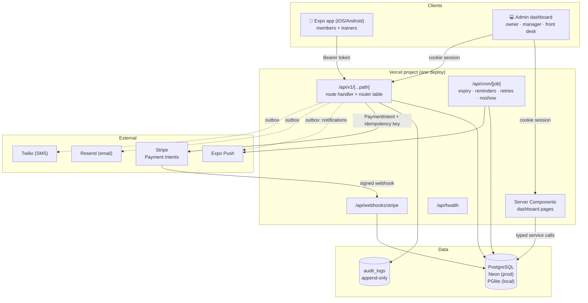
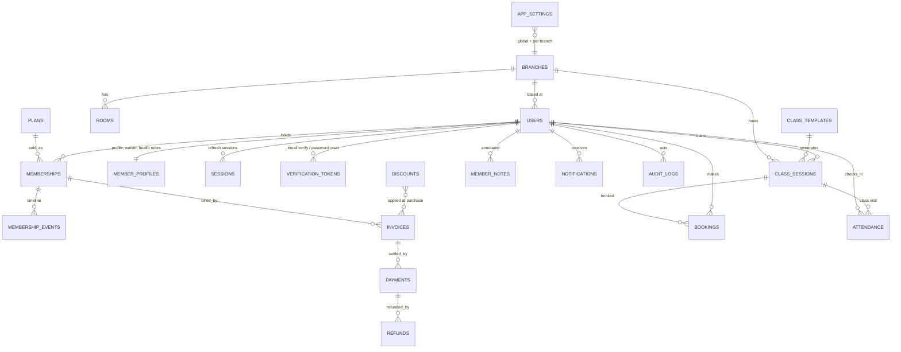

# 03 · Architecture

## System diagram



**Why one deployable instead of a separate API service:** Vercel runs functions, not
servers. Splitting the API into its own Node process would mean paying for and babysitting
a host (Fly/Render/ECS) that the MVP does not need. The dashboard's server components call
the service layer directly (no HTTP hop, no duplicated auth), while the mobile app uses the
same REST API that is documented below. If the API ever needs its own runtime, the
`lib/services/*` layer moves untouched — it takes a `Database` handle and nothing else.

## Layering rules

```
app/(admin)/**        UI: server components, no business rules
app/api/v1/**         HTTP: one catch-all handler → lib/api/router.ts (permissions live here)
lib/api/handlers/*    request → validated input → service → response envelope
lib/services/*        business rules, transactions, notifications, audit
lib/db/schema.ts      tables + indexes (the data model IS this file)
lib/domain/money.ts   pure money/proration maths (unit tested, no I/O)
```

Every service function takes `db: Database` explicitly, so it can run inside a transaction
or in a test with an in-memory database. Nothing outside `lib/db/client.ts` knows which
driver is in use.

## Request lifecycle (a booking, the busiest path)

```mermaid
sequenceDiagram
  participant App as Member app
  participant API as /api/v1/me/bookings
  participant S as bookings.bookSession
  participant DB as Postgres
  App->>API: POST { sessionId }
  API->>API: verify JWT, load user, rate/entitlement context
  API->>S: bookSession(memberId, sessionId)
  S->>DB: load session, entitlement, existing booking
  S->>DB: BEGIN; recount seats; INSERT booking (UNIQUE session+member)
  alt seat available
    DB-->>S: BOOKED, credit deducted
  else full
    DB-->>S: WAITLISTED with position
  end
  S->>DB: notification outbox row + audit row; COMMIT
  S-->>API: { waitlisted, message }
  API-->>App: 201 { data }
```

## Data model (ERD)



### Table notes

| Table | Why it exists / notable columns |
| --- | --- |
| `users` | One table for all roles. `role` + permission map beats five tables; `push_tokens` holds Expo device tokens. |
| `member_profiles` | Split from `users` because it holds sensitive data (health notes, waiver, emergency contact) that only some endpoints should return. |
| `sessions` | Refresh tokens are stored **hashed**; `revoked_at` makes "sign out everywhere" real. |
| `memberships` | `starts_at`/`ends_at`, `credits_remaining`, `frozen_days_used`, `freeze_ends_at`. Frozen time extends `ends_at`. |
| `membership_events` | Append-only timeline (created, renewed, frozen, unfrozen, changed, cancelled, expired) so "why is this member's end date what it is?" is answerable. |
| `invoices` / `payments` / `refunds` | Never edited in place except for status/paid amounts. Refunds are their own rows so the ledger reconciles. |
| `class_templates` → `class_sessions` | Recurrence is materialised into real sessions: capacity, price, penalties and rosters hang off the session, not the rule. |
| `bookings` | Unique `(session_id, member_id)`. Status: BOOKED, WAITLISTED, CANCELLED, ATTENDED, NO_SHOW. `late_cancel`, `credit_charged`. |
| `attendance` | One row per visit, with `method` (QR/MANUAL/NFC/BIOMETRIC/CLASS) and optional `session_id`. Powers peak-hours and retention. |
| `audit_logs` | Action + entity + meta + IP; the UI never updates or deletes rows. |
| `notifications` | Outbox: rows are written first, delivery state follows (`QUEUED → SENT/FAILED/SIMULATED`). |

Indexes that matter: `bookings(session_id, status)`, `class_sessions(starts_at)` and
`(branch_id, starts_at)`, `attendance(member_id, checked_in_at)`, `payments(member_id, created_at)`,
`invoices(status, issued_at)`, `users(role)`, `memberships(member_id, status)`.

## API outline

Base path `/api/v1`. Authentication is a cookie session (web) or `Authorization: Bearer`
(mobile); responses are `{ data }` or `{ error: { code, message, details } }`. The
authoritative list with permissions is `lib/api/router.ts`; `GET /api/v1` style discovery
is available via `routeIndex()`.

| Domain | Endpoints (method path → permission) |
| --- | --- |
| Auth | `POST auth/register` · `auth/login` · `auth/refresh` · `auth/logout` · `auth/verify-email` · `auth/resend-verification` · `auth/forgot-password` · `auth/reset-password` (public) · `GET/PATCH/DELETE auth/me` · `POST auth/me/password` · `GET/DELETE auth/sessions` · `DELETE auth/sessions/:id` · `POST auth/device` (signed in) |
| Member app | `GET me/home` · `me/sessions` · `me/bookings` · `POST me/bookings` · `DELETE me/bookings/:id` · `me/visits` · `me/payments` · `POST me/purchase` · `me/notifications` · `POST me/notifications/:id/read` · `me/pass` · `me/today` (signed in) |
| Trainer | `GET trainer/day` → `class:read` · `POST trainer/sessions/:id/check-in` → `attendance:write` |
| Reference | `GET branches` → `branch:read` · `POST branches` → `branch:write` · `GET reference` (trainers/rooms/branches) |
| Members | `GET members` · `GET members/:id` · `members/:id/notes` · `members/:id/timeline` → `member:read` · `POST members` · `PATCH members/:id` · `POST members/:id/notes` · `DELETE members/:id/notes/:noteId` · `POST members/bulk` → `member:write` · `DELETE members/:id` → `member:delete` |
| Plans | `GET plans` → `plan:read` · `POST plans` · `PATCH plans/:id` · `POST discounts` · `PATCH discounts/:id` → `plan:write` |
| Memberships | `GET memberships` · `GET memberships/renewals` · `GET memberships/:id` → `membership:read` · `POST memberships` · `POST memberships/:id/actions` (`renew｜freeze｜unfreeze｜cancel｜change-plan`) → `membership:write` |
| Money | `GET payments` · `GET payments/:id` → `payment:read` · `POST payments/:id/refund` → `payment:refund` · `POST payments/:id/retry` → `payment:write` · `GET invoices` · `GET invoices/:id` → `invoice:read` · `POST invoices/:id/mark-paid` → `payment:write` · `POST invoices/:id/void` → `payment:refund` |
| Classes | `GET classes` · `GET classes/:id` · `GET classes/templates` → `class:read` · `POST classes` · `PATCH classes/:id` · `POST classes/:id/cancel` · `POST/PATCH/DELETE classes/templates/:id` → `class:write` · `POST classes/:id/check-in` → `attendance:write` |
| Bookings | `GET bookings` → `booking:read` · `POST bookings` · `PATCH bookings/:id` (attended/no-show) · `DELETE bookings/:id` (penalty aware) → `booking:write` |
| Attendance | `GET attendance` · `GET attendance/floor` → `attendance:read` · `POST attendance/check-in` (QR token, member id, name search, or self) → `attendance:write` · `POST attendance/pass` (own rotating pass) |
| Reporting | `GET reports/dashboard` · `GET reports?type=…` · `GET reports/export?type=csv` → `report:read` |
| Staff | `GET staff` · `GET staff/:id/schedule` → `staff:read` · `POST staff` · `PATCH staff/:id` → `staff:write` · `GET payroll` → `report:read` |
| Communications | `GET announcements` · `GET announcements/:id/stats` → `announcement:read` · `POST announcements` · `PATCH announcements/:id` · `POST announcements/:id/send` → `announcement:write` |
| Governance | `GET audit` → `audit:read` · `GET settings` · `GET settings/system` → `setting:read` · `PATCH settings` → `setting:write` |
| Platform | `GET /api/health` · `POST /api/webhooks/stripe` (signature verified) · `GET|POST /api/cron/{expiry,reminders,retries,noshow,deliver}` (Bearer `CRON_SECRET`) |

Role → permission summary is in `lib/constants.ts`: ADMIN everything; MANAGER everything
except settings write; STAFF members/memberships/attendance/payments(take)/reports;
TRAINER class + attendance + member read; MEMBER only their own `me/*` endpoints.

## Cross-cutting concerns

- **Validation** — Zod schemas in `lib/api/schemas.ts`; handlers parse before touching the database. Errors come back as `422 validation_failed` with per-field paths.
- **Errors** — one `HttpError` type → typed JSON. A configuration error (missing `AUTH_SECRET`, `DATABASE_URL`) says exactly which variable is missing instead of "500".
- **Idempotency** — purchase/renew intents carry `purchase_{membershipId}` keys; Stripe receives them, and `payments.idempotency_key` is unique.
- **Auditing** — `writeAudit()` is called by every mutation and never throws into the caller's transaction path.
- **Notifications** — the outbox pattern: DB row first, delivery second; failure is recorded, not thrown.
- **Caching** — dashboards are `dynamic = 'force-dynamic'` (money must be current). Static assets are immutable; no Redis needed at this scale.
- **Security headers** — set globally in `next.config.ts`; cookies are httpOnly + SameSite=Lax, secure in production; CORS on `/api/v1` is wildcard-origin for token-based mobile calls only (never credentialed).
- **Privacy** — RLS-style scoping is enforced in the service layer by `userId`/`branchId` filters rather than by the client; erasure anonymises the person, keeps the ledger.

## Performance budget

| Layer | Target | How |
| --- | --- | --- |
| Dashboard page (TTFB) | < 600 ms warm | Server components query Postgres directly, no API hop, limited rows per section |
| Full page load | < 2 s on cable, < 3 s on 3G | No client-side data fetching on first paint, ~0 chart JS (SVG is rendered on the server) |
| API list endpoints | < 150 ms | Indexed filters, `LIMIT` + count query, correlated sub-selects instead of N+1 |
| Booking transaction | < 200 ms | Two reads + one write + unique constraint; no cross-service calls inside the transaction |
| Check-in round trip | < 400 ms | Single insert + entitlement read; QR verification is HMAC in-process |
