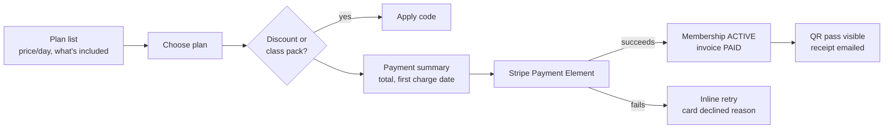
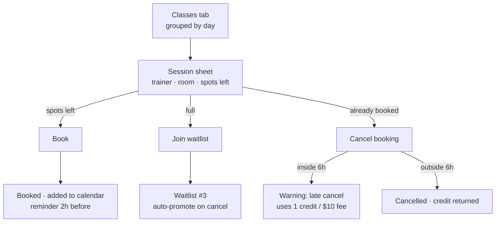
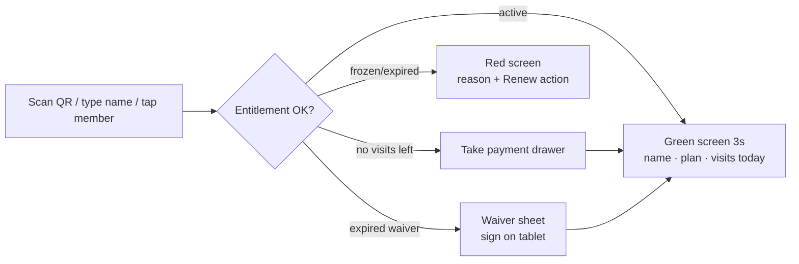

# 04 · UX

Two surfaces, one mental model: **the desk is a keyboard-driven console, the app is a
pocket card.** Same colours, same words for the same things ("Freeze", "Late cancel",
"Waitlist #3"), so a member standing at the desk and a staff member on the phone describe
the same state identically.

---

## 1. Principles

1. **The five-second check-in.** Everything at the desk is measured against it. Scan → green
   full-screen confirmation with name and photo. Staff should never need a second click.
2. **One primary action per screen.** The dashboard says what needs attention today; every
   screen has one lime button. Competing primaries are a bug.
3. **Money is never abbreviated or ambiguous.** `$1,249.00`, always two decimals, always a
   currency. "Due in 3 days" beats "2026-10-20".
4. **Errors are sentences.** "That class is full — you're #2 on the waitlist." Not "409".
5. **Trust through leftovers.** Every list shows total count, filters and last updated time.
   Empty states explain what would appear and how to create it.
6. **Keyboard is a first-class citizen.** `Ctrl/Cmd+K` search, `/` focus the check-in field,
   `Esc` closes drawers, `Tab` order follows reading order.

## 2. Personas → primary screens

| Persona | Job to be done | Entry screen | Time in app |
| --- | --- | --- | --- |
| **Maya, 29 — member** | Book tomorrow's 6:30pm class before it fills; check in with her phone | App → Home (next class card) | 20–40 s, 3–4×/week |
| **Dan, 41 — trainer** | See who's in my 7am class, mark attendance, flag an injury | App → Trainer tab | 2–3 min between classes |
| **Priya, 34 — front desk** | Sign someone up, take a payment, check people in | Web → Check-in desk | Continuous, all shift |
| **Marcus, 44 — manager** | Why did revenue dip? Who's at risk of churning? | Web → Dashboard → Reports | 15 min, daily |
| **Sofia, 38 — owner** | Is the second branch paying for itself? | Web → Reports (branch filter) | 10 min, weekly |

## 3. Core flows

### 3.1 Join and pay (mobile, or at the desk)



Guard rails: the price shown on the button is the price charged; the membership is only
`ACTIVE` after the webhook confirms (or the mock provider resolves locally), so a failed card
never opens the door.

### 3.2 Book a class (member app)



### 3.3 Check-in at the desk



The desk never blocks a check-in on a technicality: every refusal screen offers the fix
(take payment, renew, sign waiver) inline.

### 3.4 Late cancel / no-show

Member cancels 90 minutes before class → server compares against the plan's
`cancellationWindowHours` (default 6) → booking becomes `CANCELLED` with `late_cancel = true`,
one credit is consumed (or a $10 penalty invoice is raised), the seat is offered to the
waitlist, and the member sees *"Late cancel — 1 credit used. You have 3 left."* If nobody is
promoted and the member never arrives, the cron sweep marks `NO_SHOW` after the class ends.

### 3.5 Freeze a membership

Staff: member → Membership card → **Freeze** → days (7/14/30/custom + reason). The dialog
shows the consequence before commit: *"End date moves from Mar 14 to Mar 28. 14 of 30 freeze
days used."* Frozen members can't book or check in; the app shows a frozen banner with the
return date.

---

## 4. Wireframes

### 4.1 Web — dashboard (1440×900)

```
┌──────────────────────────────────────────────────────────────────────────────┐
│ ◤ IRONHOUSE   [⌘K Search members, classes…]            ◉ 3 alerts   Priya ▾  │
├────────────┬─────────────────────────────────────────────────────────────────┤
│ OVERVIEW   │  Tuesday, 17 October                        [Branch: Downtown ▾] │
│  Dashboard │  ┌──────────┬──────────┬──────────┬──────────┐                   │
│  Check-in  │  │ Active   │ MRR      │ Overdue  │ Today's  │                   │
│  Members   │  │ 1,284    │ $18,420  │ $1,260   │ visits   │                   │
│  Classes   │  │ +37 30d  │ +4.1%    │ 9 inv.   │ 214      │                   │
│  Plans     │  └──────────┴──────────┴──────────┴──────────┘                   │
│  Payments  │  ┌───────────────────────────────┬─────────────────────────┐     │
│  Reports   │  │ Today's classes          12  │ Needs attention      5  │     │
│  Staff     │  │ 06:30 Spin · Lina · 18/20 ▮▮▮│ EXPIRED · Ava Chen  →   │     │
│  Messages  │  │ 07:15 HIIT · Dan · 20/20 FULL │ PAYMENT · N. Okafor →   │     │
│  Settings  │  │ 09:00 Yoga · Mei · 9/16       │ WAIVER · J. Silva   →   │     │
│            │  └───────────────────────────────┴─────────────────────────┘     │
│ ─────────  │  ┌───────────────────────────────┬─────────────────────────┐     │
│ Priya S.   │  │ Revenue, 14 days   ▁▂▃▅▆▅▇▆▅▆▇█ │ Front desk queue        │     │
│ Front desk │  └───────────────────────────────┴─────────────────────────┘     │
└────────────┴─────────────────────────────────────────────────────────────────┘
```

### 4.2 Web — check-in desk (the highest-frequency screen)

```
┌──────────────────────────────────────────────────────────────────────────────┐
│  CHECK-IN                                    [ / ] focus   [Manual ▾]  [Scan]│
│  ┌────────────────────────────────────────────────────────────────────────┐  │
│  │  Type a name, phone, or member ID…                                     │  │
│  └────────────────────────────────────────────────────────────────────────┘  │
│                                                                              │
│  ┌──────────────────────────────────────┐   ON THE FLOOR NOW        38     │
│  │ ✓  MAYA PATEL                        │   ──────────────────────────────   │
│  │    Annual · 24 visits left            │   06:41  Lina Haas   Spin         │
│  │    Checked in 06:41 · member since 22 │   06:38  Tom Reyes   —            │
│  │                                       │   06:32  Ava Chen   —            │
│  └──────────────────────────────────────┘   06:29  Noah Kim   HIIT         │
│                                                                              │
│  Recent at this desk:  Ava Chen 07:02 · Tom Reyes 06:58 · Mei Lin 06:44      │
└──────────────────────────────────────────────────────────────────────────────┘
```

### 4.3 Web — member detail

```
┌──────────────────────────────────────────────────────────────────────────────┐
│ ← Members                                                                    │
│  ┌────┐  MAYA PATEL              [ACTIVE]        [Message] [Renew] [⋯]       │
│  │ MP │  maya.patel@example.com · +1 415 555 0132 · Downtown · since Mar 24 │
│  └────┘  Annual Unlimited · ends 14 Mar 2027 · 24 class credits              │
├──────────────────────────────────────────────────────────────────────────────┤
│ [Overview] [Membership] [Bookings] [Payments] [Attendance] [Notes]           │
│  ┌ Membership ─────────────────────────────┐ ┌ Visits (90d) ────────────┐   │
│  │ Annual Unlimited        ACTIVE          │ │ ▁▃▅▂▇▅▃▆▄▅█▆ 34 visits    │   │
│  │ $149.00 / month · auto-renew on         │ └──────────────────────────┘   │
│  │ Started 14 Mar 2026 · Ends 14 Mar 2027  │ ┌ Upcoming ────────────────┐   │
│  │ [Freeze] [Change plan] [Cancel]         │ │ Tue 18:30 Spin · booked  │   │
│  └─────────────────────────────────────────┘ │ Thu 07:15 HIIT · waitlist│   │
│  ┌ Next payment ───────────────────────────┐ └──────────────────────────┘   │
│  │ $149.00 on 14 Nov · Visa •••• 4242      │ ┌ Notes ──────────────────┐   │
│  └─────────────────────────────────────────┘ │ 12 Oct — knee niggle…   │   │
└──────────────────────────────────────────────────────────────────────────────┘
```

### 4.4 Mobile — member home and pass

```
   ┌─────────────────────────┐      ┌─────────────────────────┐
   │ 6:41            🔔  ●   │      │  ‹  CHECK-IN PASS      │
   │                         │      │                         │
   │ Good evening, Maya      │      │   ┌─────────────────┐   │
   │ ┌─────────────────────┐ │      │   │ ▓▓▓ ▓ ▓▓▓ ▓ ▓▓▓ │   │
   │ │ NEXT CLASS     2h   │ │      │   │ ▓ ▓▓▓ ▓ ▓▓▓ ▓ ▓ │   │
   │ │ Spin · Lina Haas    │ │      │   │ ▓▓▓ ▓ ▓▓▓ ▓ ▓▓▓ │   │
   │ │ Tue 18:30 · Studio 2│ │      │   └─────────────────┘   │
   │ │ [ View booking ]    │ │      │   MAYA PATEL            │
   │ └─────────────────────┘ │      │   Annual Unlimited      │
   │ ┌─────────────────────┐ │      │   Valid to 14 Mar 2027  │
   │ │ MEMBERSHIP  ACTIVE  │ │      │   Refreshes every 30s   │
   │ │ 24 visits left      │ │      │                         │
   │ │ renews 14 Nov  ▸    │ │      │   [ Open scanner ]      │
   │ └─────────────────────┘ │      └─────────────────────────┘
   │ [Book] [Pass] [History] │
   └─────────────────────────┘
```

### 4.5 Mobile — trainer roster

```
   ┌─────────────────────────┐
   │ Today · Tue 17 Oct      │
   │ ┌─────────────────────┐ │
   │ │ 07:15  HIIT   20/20 │ │
   │ │ Studio 1 · full     │ │
   │ │ ✓ 14 checked in     │ │
   │ └─────────────────────┘ │
   │ Attendees               │
   │ ✓ Ava Chen    06:58     │
   │ ✓ Tom Reyes   07:02     │
   │ ○ Noah Kim    —         │
   │ ○ Priya Shah  WL        │
   │ [ Check in by list ]    │
   └─────────────────────────┘
```

---

## 5. Design system

Source of truth: [`app/globals.css`](../app/globals.css) (web) and
[`apps/mobile/lib/theme.ts`](../apps/mobile/lib/theme.ts) (app). Both use the same hex values.

### Colour (Obsidian & Clean White Luxe)

| Token | Hex | Use |
| --- | --- | --- |
| `ink-950` | `#09090b` | App backdrop (pure deep obsidian) |
| `ink-900` / `ink-850` / `ink-800` | `#121215` `#18181b` `#202024` | Elevated surfaces, cards, raised rows |
| `ink-700` / `ink-600` | `#27272a` `#3f3f46` | Clean neutral borders, dividers, inputs |
| `ink-400` / `ink-300` | `#71717a` `#a1a1aa` | Muted labels / secondary text |
| `ink-200` / `ink-100` | `#e4e4e7` `#fafafa` | Table cells, headings, pure white primary text |
| `white` / Primary CTA | `#ffffff` | Clean white high-contrast button, focal actions |
| `emerald-400` / `emerald-500` | `#34d399` `#10b981` | Success / paid / attended / active (subtle translucent badge) |
| `amber-400` / `amber-500` | `#fbbf24` `#f59e0b` | Warning / pending / frozen / waitlist |
| `rose-400` / `rose-500` | `#fb7185` `#f43f5e` | Danger / failed / expired / no-show |
| `sky-400` | `#38bdf8` | Informational, calendar highlights |

Status is **never colour-only**: every badge carries an explicit text label paired with a subtle translucent fill and border. The high-contrast dark & white design delivers effortless legibility under both harsh gym floodlights and dim studio floors.

### Type

| Role | Size / weight | Notes |
| --- | --- | --- |
| Page title | 24px / 650 | `tracking-tight`, crisp white |
| Section title | 15px / 600 | With count chip |
| Body | 14px / 400 | Line-height 1.55 |
| Table cell | 13px / 400 | Tabular numerals for money and dates |
| Label / meta | 11px / 600 | Uppercase, `0.08em` tracking |
| Stat value | 28px / 650 | Tabular numerals, `-0.025em` |

System font stack on purpose: zero webfont bytes, no FOUT, native on every OS.

### Spacing, radius, elevation

- 4px base scale: `4 · 8 · 12 · 16 · 24 · 32 · 48`.
- Radii: 8 (inputs, badges), 12 (buttons, rows), 16 (cards).
- Cards: 1px `#27272a` border + a subtle specular top-lit gradient. Clean elevation.
- Touch targets ≥ 44×44px on mobile, ≥ 36px on web (dense tables).
- Focus: 2px clean white ring, 2px offset, `:focus-visible` only.

### Components

`components/ui.tsx` — `Card`, `Stat`, `Badge`, `Table`, `EmptyState`, `Button`, `Field`,
`Select`, `Textarea`, `Toolbar`, `PageHeader`, `Money`, `Avatar`, `ProgressBar`, `Pagination`.
Composition over configuration: pages assemble these; no page defines its own button.

### Motion

120ms ease-out on hover/focus, 180ms on drawers. Respects
`prefers-reduced-motion: reduce` (transitions collapse to 0ms). Nothing animates on data
refresh — the desk must feel instant, not lively.

### Accessibility checklist

- [x] All text ≥ 4.5:1; interactive borders ≥ 3:1.
- [x] Every input has a programmatic label; errors are `aria-describedby`.
- [x] Tables use `<th scope="col">`; sortable headers are buttons.
- [x] Status conveyed by word + colour.
- [x] Focus is trapped in dialogs, returns to the trigger on close, `Esc` closes.
- [x] Charts have a text summary in the DOM (screen reader reads the numbers, not the SVG).
- [x] Works at 320px width (single column) and at 200% browser zoom.
- [x] Errors announced via `role="alert"`; success confirmations are polite live regions.

### Content voice

| Instead of | Write |
| --- | --- |
| "Invalid request" | "That email and password don't match." |
| "Membership not active" | "Maya's membership expired on 3 Oct. Renew to check her in." |
| "0 results" | "No members match “okafor”. Try a phone number, or clear the filter." |
| "Success" | "Payment recorded — $149.00, Visa •••• 4242." |
