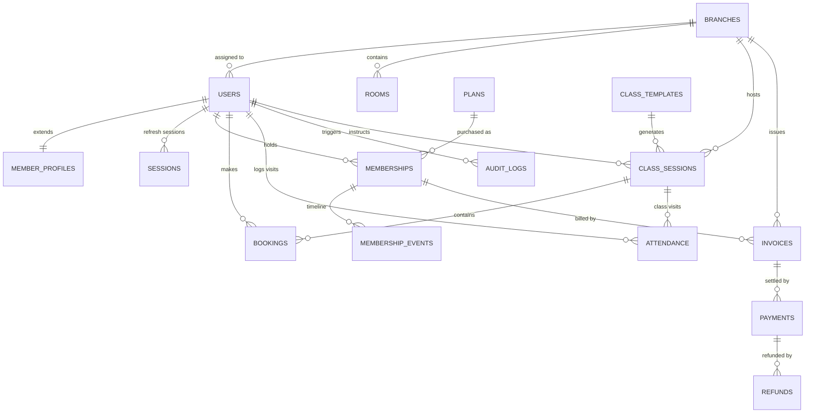
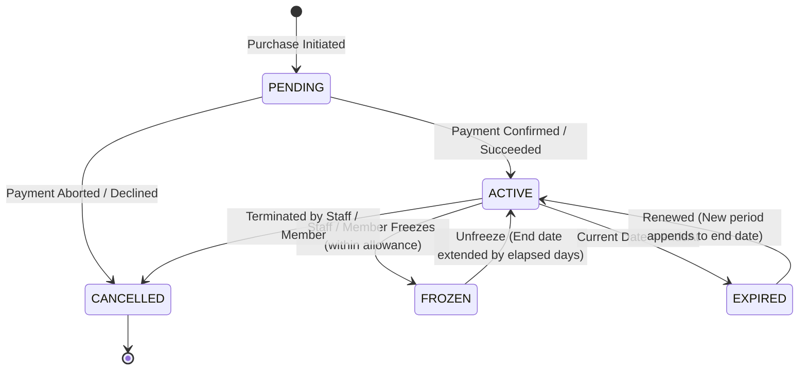
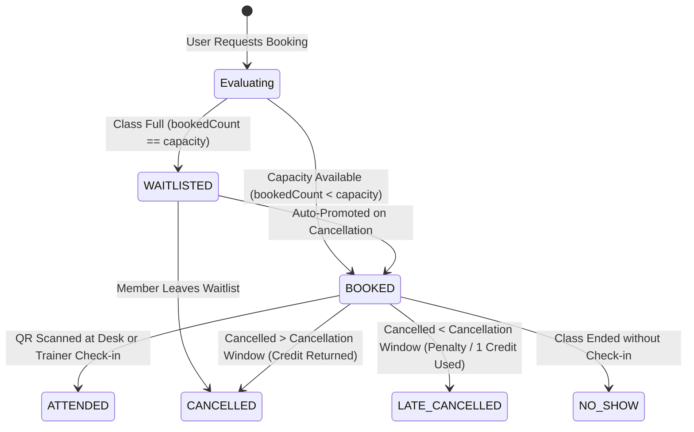

# Gym Management System — Master Build Specification & Engineering Brief

> **Single Source of Truth** for the Ironhouse Gym Management Platform.
> This specification defines product requirements, the **Obsidian & Clean White Luxe** design system,
> comprehensive data structures, state machine lifecycles, and production delivery standards.
> Both the **Web Operations Console** and the **Mobile Member/Trainer App** must strictly adhere
> to these design and architectural standards to ensure an ultra-clean, professional, and unified experience.

**Status:** Production-Ready Architecture & MVP Implementation  
**Repo Layout:** Modular Architecture (`apps/mobile` Expo, Next.js 16 Web Console & REST API under `/api/v1`)  
**Design Paradigm:** Obsidian & Clean White Luxe (High-Contrast Monochrome with Precision Status Accents)  
**Last Updated:** 2026-10-17  

---

## 1. Product Summary & System Vision

Ironhouse replaces paper sign-in sheets, fragmented spreadsheets, and clunky legacy front-desk terminals with a unified, high-performance platform for independent gyms and multi-branch fitness chains.

```
┌─────────────────────────────────────────────────────────────────────────────────┐
│                                IRONHOUSE PLATFORM                               │
├───────────────────────────────┬─────────────────────────────────────────────────┤
│  📱 Member & Trainer App       │  💻 Web Operations Console                      │
│  (iOS / Android via Expo)      │  (Next.js 16 App Router · Server Components)    │
│  - Rotating Dynamic QR Pass   │  - 5-Second Rapid Check-in Console              │
│  - 1-Tap Class Booking & WL   │  - Real-time Floor & Attendance Roster          │
│  - Digital Waiver & Profile   │  - Immutable Billing & Ledger Reconciliation    │
│  - Trainer Roster & Check-in  │  - Class Timetable & Capacity Management        │
│  - Push Alerts & Reminders    │  - Multi-Branch Analytics & Audit Trail         │
├───────────────────────────────┴─────────────────────────────────────────────────┤
│                  ⚡ REST API Engine & Shared Domain Services                     │
│    (/api/v1/* · Zod Edge Validation · Drizzle ORM · PGlite Local / Neon Prod)   │
└─────────────────────────────────────────────────────────────────────────────────┘
```

### Core Product Principles

1. **The 5-Second Front Desk Guarantee:** Check-in and member lookup must complete in under 5 seconds. Keyboard-first navigation (`/` to focus search, `Ctrl/Cmd+K` palette, `Esc` dismiss), offline-tolerant local cache, and zero-latency feedback.
2. **Obsidian & Clean White Minimalism:** No garish, muddy, or amateur neon color schemes. A disciplined, high-contrast monochrome design language (deep obsidian surfaces, razor-sharp clean white typography, refined neutral borders, and subtle translucent status badges).
3. **Immutable Financial Ledger:** Money is never edited in place or ambiguous. Every fee, charge, refund, and discount is an append-only ledger transaction with full audit trails.
4. **Strict Data State Machines:** Entitlements, memberships, class capacity, waitlists, and attendances are governed by deterministic finite state machines. No orphan states or double-bookings.
5. **Zero Webfont Lag & High Performance:** Fast first paint (<1.2s), native system font hierarchy, tabular numbers for monetary/metric displays, and instant optimistic feedback.

---

## 2. "Obsidian & Clean White Luxe" UI/UX Design System

Both the **Web Console** and **Mobile App** share an identical visual language, creating an immediate sense of polish, premium craft, and professional authority.

### 2.1 Color Palette & Contrast Tokens

The palette pairs deep, neutral obsidian darks with pristine, crisp whites and subtle specular borders. Semantic colors are strictly reserved for live operational states.

| Token | Hex Value | Web (Tailwind / CSS Var) | Mobile Token (`theme.ts`) | Purpose |
| --- | --- | --- | --- | --- |
| **Obsidian 950** | `#09090b` | `--color-ink-950` / `bg-ink-950` | `colors.ink950` | Primary app canvas / backdrop |
| **Surface 900** | `#121215` | `--color-ink-900` / `bg-ink-900` | `colors.ink900` | Elevated panels, sidebars, sheets |
| **Card Surface 850** | `#18181b` | `--color-ink-850` / `bg-ink-850` | `colors.ink850` | Primary card containers, tables |
| **Raised Surface 800** | `#202024` | `--color-ink-800` / `bg-ink-800` | `colors.ink800` | Hover states, raised chips, input fills |
| **Border Neutral 700** | `#27272a` | `--color-ink-700` / `border-ink-700` | `colors.ink700` | Default card borders, dividers (3:1 contrast) |
| **Border Active 600** | `#3f3f46` | `--color-ink-600` / `border-ink-600` | `colors.ink600` | Focused borders, active state dividers |
| **Muted Text 400** | `#71717a` | `--color-ink-400` / `text-ink-400` | `colors.ink400` | Meta labels, captions, uppercase hints |
| **Secondary Text 300** | `#a1a1aa` | `--color-ink-300` / `text-ink-300` | `colors.ink300` | Secondary descriptions, subtitles (AA on 900) |
| **High-Read Text 200** | `#e4e4e7` | `--color-ink-200` / `text-ink-200` | `colors.ink200` | Table cell data, subheadings |
| **Pure Crisp White 100**| `#fafafa` / `#ffffff` | `--color-ink-100` / `text-white` | `colors.ink100` / `colors.white` | Primary headlines, metric values, high contrast |
| **Primary White Action**| `#ffffff` | `bg-white text-ink-950` | `colors.lime` (white CTA) | Primary CTA buttons, focused badge states |

#### Semantic Status Accents (Refined & Subtle)

Status is **never color-only** — badges always pair an explicit text descriptor with a subtle translucent fill and colored border:

- **Emerald (Active / Succeeded / Paid / Checked-in):** Fill `rgba(16, 185, 129, 0.10)`, Border `rgba(16, 185, 129, 0.25)`, Text `#34d399`
- **Amber (Pending / Frozen / Waitlist / Aging Invoice):** Fill `rgba(245, 158, 11, 0.10)`, Border `rgba(245, 158, 11, 0.25)`, Text `#fbbf24`
- **Rose (Expired / Cancelled / Failed / No-Show):** Fill `rgba(244, 63, 94, 0.10)`, Border `rgba(244, 63, 94, 0.25)`, Text `#fb7185`
- **Sky (Scheduled / Informational / Broadcast):** Fill `rgba(56, 189, 248, 0.10)`, Border `rgba(56, 189, 248, 0.25)`, Text `#38bdf8`

### 2.2 Typography Hierarchy

- **Font Family:** Native system font stack (`-apple-system, BlinkMacSystemFont, 'Segoe UI', Roboto, Helvetica, Arial, sans-serif`). Zero layout shift (FOUT), instant rendering, native platform feel.
- **Page Titles:** `24px / 650` (`tracking-tight`), crisp white (`#ffffff`).
- **Section Headers:** `15px / 600` with subtle count badge.
- **Body Text:** `14px / 400` with line-height `1.55`, secondary text (`#a1a1aa`).
- **Table Data & Currency:** `13px` with `tabular-nums` (`font-variant-numeric: tabular-nums; -0.025em tracking`).
- **Uppercase Metadata:** `11px / 600` (`uppercase`, `tracking-wider`, `#71717a`).

### 2.3 Component Blueprint & Visual Standards

1. **Cards & Panels:**
   - Background: `linear-gradient(180deg, rgba(255, 255, 255, 0.025) 0%, rgba(255, 255, 255, 0) 100%), #18181b`.
   - Border: `1px solid #27272a`.
   - Radius: `16px` (`rounded-2xl`).
   - Shadow: `0 4px 20px -2px rgba(0, 0, 0, 0.45)`.
2. **Buttons:**
   - **Primary CTA:** Clean crisp white background (`#ffffff`), pitch dark text (`#09090b`), font-weight 600, hover to `#e4e4e7`, subtle active micro-scale (`active:scale-[0.99]`).
   - **Secondary Button:** Surface dark (`#202024`), border `1px solid #27272a`, text `#fafafa`, hover to `#27272a`.
   - **Danger Button:** `bg-rose-500/10 text-rose-400 border border-rose-500/25 hover:bg-rose-500/20`.
   - **Touch Target:** Minimum `44×44px` on mobile, `36px` height on desktop data tables.
3. **Form Inputs & Selects:**
   - Height `44px`, background `#121215`, border `1px solid #27272a`, placeholder `#71717a`, text `#fafafa`.
   - Focus ring: `outline: none; border-color: #a1a1aa; box-shadow: 0 0 0 1px #a1a1aa`.
4. **Data Tables:**
   - Compact table headers with uppercase `11px` labels.
   - Row dividers with `#202024`. Row hover with subtle highlight `hover:bg-ink-800/50`.
   - Empty states include a clear descriptive explanation and an immediate single-click action.

---

## 3. Comprehensive Data Structure & Entity Architecture

The data architecture is fully normalized, strictly typed, branch-scoped, and audit-logged.

### 3.1 Entity Relationship Diagram (ERD)



### 3.2 Canonical Data Schemas

#### 1. Core Users & Roles
```typescript
interface User {
  id: string              // UUID v4
  branchId: string | null // Scoped branch ID
  email: string           // Unique, normalized lowercase
  phone: string | null    // Unique, E.164 formatted
  passwordHash: string    // bcrypt hash
  firstName: string
  lastName: string
  role: 'OWNER' | 'ADMIN' | 'MANAGER' | 'STAFF' | 'TRAINER' | 'MEMBER'
  status: 'ACTIVE' | 'SUSPENDED' | 'PENDING'
  avatarUrl: string | null
  jobTitle: string | null
  hourlyRateCents: number | null // For payroll export
  pushTokens: string[]           // Expo push tokens
  createdAt: string              // ISO 8601
  updatedAt: string
}

interface MemberProfile {
  id: string
  userId: string                 // 1-to-1 with User
  dateOfBirth: string | null     // YYYY-MM-DD
  gender: string | null
  addressLine: string | null
  city: string | null
  postalCode: string | null
  emergencyContactName: string | null
  emergencyContactPhone: string | null
  healthNotes: string | null     // Par-Q / injuries (restricted access)
  waiverSignedAt: string | null  // ISO timestamp of digital signature
  waiverVersion: string | null
  marketingOptIn: boolean
}
```

#### 2. Plans & Memberships
```typescript
interface Plan {
  id: string
  branchId: string | null        // null = all branches
  name: string                   // e.g., "Annual Unlimited", "10-Class Pack"
  slug: string
  type: 'UNLIMITED' | 'CLASS_PACK' | 'DAY_PASS' | 'RECURRING'
  intervalDays: number | null    // 30, 365
  priceCents: number             // Minor currency units (e.g., $149.00 -> 14900)
  classCredits: number | null    // null = unlimited
  freezeAllowanceDays: number    // Yearly max freeze days (e.g., 30)
  cancellationWindowHours: number // Late cancel threshold (default 6)
  isActive: boolean
}

interface Membership {
  id: string
  userId: string
  planId: string
  branchId: string
  status: 'ACTIVE' | 'FROZEN' | 'EXPIRED' | 'CANCELLED' | 'PENDING'
  startsAt: string               // ISO timestamp
  endsAt: string                 // Extended automatically when frozen
  creditsRemaining: number | null
  frozenDaysUsed: number
  freezeEndsAt: string | null
  autoRenew: boolean
  cancelledAt: string | null
  cancelReason: string | null
}
```

#### 3. Timetable, Sessions & Capacity Allocations
```typescript
interface ClassSession {
  id: string
  branchId: string
  templateId: string | null
  roomId: string | null
  trainerId: string | null
  title: string
  startsAt: string               // ISO timestamp
  endsAt: string
  capacity: number               // Max spots on the floor (e.g. 20)
  bookedCount: number            // Current confirmed bookings
  waitlistCount: number          // Current waitlist entries
  status: 'SCHEDULED' | 'IN_PROGRESS' | 'COMPLETED' | 'CANCELLED'
}

interface Booking {
  id: string
  sessionId: string
  memberId: string
  status: 'BOOKED' | 'WAITLISTED' | 'ATTENDED' | 'CANCELLED' | 'NO_SHOW'
  waitlistPosition: number | null // 1, 2, 3...
  lateCancel: boolean            // Flagged if cancelled within cancellation window
  creditCharged: boolean         // Whether a credit or fee penalty was incurred
  bookedAt: string
  cancelledAt: string | null
}
```

#### 4. Immutable Billing, Invoices & Ledger
```typescript
interface Invoice {
  id: string
  branchId: string
  memberId: string
  membershipId: string | null
  number: string                 // Sequential human-readable, e.g. "INV-2026-0041"
  status: 'DRAFT' | 'OPEN' | 'PAID' | 'VOID' | 'UNCOLLECTIBLE'
  subtotalCents: number
  taxCents: number               // Tax-inclusive breakdown
  totalCents: number
  issuedAt: string
  dueAt: string
  paidAt: string | null
}

interface Payment {
  id: string
  invoiceId: string
  memberId: string
  provider: 'STRIPE' | 'CASH' | 'TERMINAL' | 'MOCK'
  status: 'SUCCEEDED' | 'PENDING' | 'FAILED' | 'REFUNDED'
  amountCents: number
  currency: string               // 'USD'
  externalPaymentId: string | null // Stripe PaymentIntent ID (pi_...)
  receiptUrl: string | null
  createdAt: string
}

interface Refund {
  id: string
  paymentId: string
  amountCents: number
  reason: 'DUPLICATE' | 'REQUESTED_BY_CUSTOMER' | 'FRAUDULENT' | 'SERVICE_CREDIT'
  notes: string | null
  createdById: string            // Staff who issued the refund
  createdAt: string
}
```

#### 5. Check-in, Access & Attendance
```typescript
interface Attendance {
  id: string
  branchId: string
  memberId: string
  sessionId: string | null       // Optional link to booked class
  method: 'QR' | 'MANUAL' | 'NFC' | 'KIOSK' | 'CLASS_ROSTER'
  checkedInAt: string
  staffUserId: string | null     // Present if manually admitted by staff
}

/** Dynamic 60-Second Rotating Pass Payload */
interface PassPayload {
  token: string                  // HMAC-SHA256 signed JWT
  expiresAt: string              // 60-second TTL
  memberId: string
  memberName: string
  membershipStatus: string
  visitsToday: number
}
```

### 3.3 Domain State Machines

#### 1. Membership Lifecycle


#### 2. Class Booking & Capacity Lifecycle


### 3.4 Standardized API Response Envelopes

All HTTP endpoints return standardized JSON contracts:

```typescript
// Standard Success Response
interface ApiResponse<T> {
  data: T
  meta?: {
    total?: number
    page?: number
    pageSize?: number
    timestamp: string
  }
}

// Standard RFC-7807 Compliant Error Response
interface ApiErrorResponse {
  error: {
    code: string        // e.g. "CLASS_FULL", "MEMBERSHIP_FROZEN", "UNAUTHORIZED"
    message: string     // Human-readable sentence explaining the issue
    details?: unknown   // Validation error array or contextual metadata
  }
}
```

---

## 4. Web Console & Mobile App Specifications

### 4.1 Web Operations Console (Desktop & Tablet)

- **Layout Grid:** Fixed sleek sidebar (`lg:w-64`) with clear grouping: *Run the gym* (Overview, Check-in, Timetable, Members), *Money* (Payments, Plans & Pricing), *Insight* (Reports, Staff & Payroll, Announcements), *Settings* (Audit log, Settings).
- **5-Second Check-in Desk (`/checkin`):**
  - Instant focus on load (`/` shortcut).
  - Search members across names, phones, emails, and member numbers with zero debounce lag.
  - Big visual status confirmation:
    - **Green Full-Screen Banner:** "Maya Patel · Annual Unlimited · 24 visits left · ADMITTED".
    - **Red Attention Banner:** "Noah Kim · Membership Expired on 12 Oct · [Quick Renew Button]".
    - **Inline Action Drawers:** Take card/cash payment, update expired waiver, unfreeze membership without leaving the check-in desk.
- **Data Tables & Filters:**
  - Sticky table headers, responsive scrolling with sleek custom scrollbars.
  - Filter toolbar with instant search, status dropdowns, date pickers, and direct CSV export.
  - Real-time stat summary cards with tabular numbers and trend sparklines.

### 4.2 Mobile Member & Trainer App (Expo iOS/Android)

- **Member Home Tab (`/`):**
  - **Dynamic Pass Card:** High-contrast pure white QR box (ensures flawless barcode scanning under dim gym floor lighting).
  - Countdown timer: "Refreshes in 42s" with live rotating cryptographic token.
  - Next Class Card: 1-tap view of tomorrow's class with studio location and trainer photo.
  - Membership Status Chip: Clean badge with expiration date and remaining visits count.
- **Classes Tab (`/classes`):**
  - Horizontal calendar day selector with dot indicators for booked sessions.
  - Session Card: Class title, trainer name, room, time, spots remaining pill (`18/20`).
  - 1-Tap Booking with instantaneous optimistic UI update.
- **Trainer View Tab (`/trainer`):**
  - Filtered view of today's classes assigned to the signed-in trainer.
  - Full attendee roster with check-in toggles (`Attended`, `No-show`) and flagged health/injury notes.

---

## 5. Security, Concurrency & Database Indexing

1. **Atomic Booking Concurrency:**
   - Class capacity updates run inside an explicit PostgreSQL `SERIALIZABLE` transaction or utilize a conditional atomic query:
     `UPDATE class_sessions SET booked_count = booked_count + 1 WHERE id = $1 AND booked_count < capacity`
   - Guaranteed prevention of race conditions during peak 7:00:00 booking stampedes.
2. **Essential Database Indexes:**
   - `bookings(session_id, status)` — Instant class roster and capacity counts.
   - `class_sessions(branch_id, starts_at)` — Fast timetable queries.
   - `attendance(member_id, checked_in_at)` — Rapid attendance history lookup.
   - `invoices(status, due_at)` — Instant overdue debt scanning.
   - `users(role, branch_id)` — Rapid role-based querying.
   - `memberships(user_id, status)` — O(1) entitlement check during check-in.
3. **Session & Token Security:**
   - Web authentication: httpOnly, secure, SameSite=Lax JWT cookies.
   - Mobile authentication: Secure store Bearer tokens with 15-minute access JWT and 30-day hashed rotating refresh tokens.
   - Device revocation: Revoking a session or changing a password invalidates all device refresh tokens immediately.

---

## 6. How to Run, Test & Deploy

```bash
# 1. Install workspace dependencies
npm install

# 2. Configure environment variables
cp .env.example .env          # AUTH_SECRET is required; DATABASE_URL stays empty for local PGlite

# 3. Setup embedded database, run migrations and seed demo data
npm run db:reset              # Pre-seeds branches, plans, sessions, and demo accounts

# 4. Start local development server (Web Console + REST API)
npm run dev                   # http://localhost:3000

# 5. Run full test suite (Vitest + PGlite in-memory)
npm test                      # 47 unit + integration tests

# 6. Typecheck entire repository
npm run typecheck

# 7. Start Mobile App (Expo)
cd apps/mobile && npm install && npm start
```

### Seeded Demo Accounts (Password: `Passw0rd!`)

| Role | Email | Capabilities |
| --- | --- | --- |
| **Admin / Owner** | `admin@ironhouse.test` | Full platform control, billing, reports, audit trail, multi-branch |
| **Manager** | `manager@ironhouse.test` | Branch operations, refunds, member overrides, staff management |
| **Front Desk** | `frontdesk@ironhouse.test` | Rapid check-in desk, new member sales, attendance search |
| **Trainer** | `trainer@ironhouse.test` | Class roster attendance, member health notes |
| **Member** | `member@ironhouse.test` | Mobile app booking, dynamic QR check-in, payment history |

---

## 7. Definition of Done (Quality Checklist)

Every new feature or screen must satisfy:
- [x] **Dark & White Aesthetic:** Conforms strictly to Obsidian 950 canvas, crisp white typography, `#27272a` borders, and subtle semantic status badges.
- [x] **5-Second Check-in Ready:** Keyboard navigable, accessible touch targets (≥44px), zero blocking network waterfalls.
- [x] **Typed Endpoints & Validation:** Zod schema validation at HTTP edge, standardized `{ data }` / `{ error }` response envelopes.
- [x] **Immutable Financial Ledger:** Financial mutations write an append-only transaction row with audit logging.
- [x] **Automated Tests:** Comprehensive unit and integration test coverage with zero regressions.
